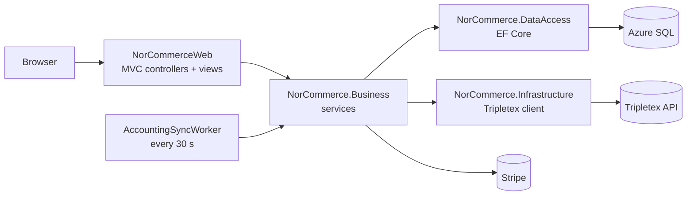

# NorCommerce

A bilingual (Norwegian / English) online bookstore with Stripe payments and automatic invoicing in Tripletex, built with ASP.NET Core MVC on .NET 10.


**[Live demo](https://bit.ly/47H3ZtG)** · Register a customer account and pay with Stripe test card `4242 4242 4242 4242`

> Free Azure tier. The first visit can take 20 to 40 seconds while the app wakes up.


---

## Highlights

- **Bilingual UI (NO / EN).** 179 translated keys across the store, admin panel and login pages. One-click switch, remembered for a year.
- **Norwegian formats, always.** Text language is separate from number and date culture, so English users still see `kr 349,00` and `27.10.2026`.
- **Tripletex accounting integration.** A background worker turns paid orders into customers, orders and invoices in Tripletex, then emails the invoice PDF.
- **Retry-safe processing.** Each sync step is saved as soon as it succeeds, so a failed run continues where it stopped instead of creating duplicate invoices.
- **Stripe payments and refunds.** Checkout in NOK, and refunds straight from the admin order page.
- **Realistic demo data.** 80 books (incl. Hamsun and Norwegian folk tales), 200 customers with real Norwegian postal codes, and 3 years of orders with Christmas peaks.
- **CI/CD to Azure.** Every push to `master` deploys to Azure App Service with GitHub Actions.

---

## Features

**Customers**
- Browse books by category, with covers from the Open Library API
- Quantity pricing (1+, 50+, 100+)
- Cart saved per user, with a live counter in the navbar
- Stripe Checkout, order history, and emails when an order is confirmed, shipped or refunded

**Admins and employees**
- Dashboard with revenue, orders, products, users and 6-month charts (Chart.js)
- Manage products (with image upload) and categories
- Order flow: Pending → Approved → Processing → Shipped, or Cancelled / Refunded
- Manage users: change roles, lock and unlock accounts

---

## How it works

### Architecture



| Project | Responsibility |
|---|---|
| `NorCommerceWeb` | Controllers, Razor views, areas (Customer, Admin, Identity), background worker |
| `NorCommerce.Business` | Business logic in services behind interfaces, email templates |
| `NorCommerce.DataAccess` | `DbContext`, migrations, demo data seeder |
| `NorCommerce.Infrastructure` | External services (Tripletex API client) |
| `NorCommerce.Models` | Entities and view models |
| `NorCommerce.Utility` | Shared constants (roles, statuses) |

Controllers stay thin. Services are injected through interfaces (`IOrderService`, `IPaymentService`, `IAccountingService`, ...), and the business layer only knows `IAccountingClient`, not Tripletex itself.

### Tripletex sync

`AccountingSyncWorker` (`BackgroundService` + `PeriodicTimer`) runs every 30 seconds:

1. Find the customer in Tripletex by email, or create one
2. Create the order with order lines and VAT
3. Invoice the order
4. Download the invoice PDF and email it to the customer

Key decisions:
- **Save after every step** (`AccountBookOrderId`, `AccountBookInvoiceId`, `InvoiceEmailSent`), so a retry picks up at the failed step
- **One DI scope and one `try/catch` per order**, so one failing order does not block the rest
- **Token cached** in a singleton and refreshed only before it expires
- **Typed `HttpClient`** and the **Options pattern** for configuration
- **`SyncFromDate` setting**, so seeded history is never sent to Tripletex

### Localization

```csharp
SupportedCultures   = new[] { norwegian },           // kr and dates stay Norwegian
SupportedUICultures = new[] { norwegian, english }   // text in Norwegian or English
```

Text lives in `SharedResource.nb-NO.resx` and `SharedResource.en.resx`, injected with `IStringLocalizer` in every area. The selected language is stored in a culture cookie.

### Security

- No secrets in the repo: user-secrets locally, App Service settings in Azure
- Anti-forgery validation on every POST (global filter)
- Role-based authorization on admin controllers
- Security stamp validated on every request, so locked or demoted users are signed out immediately
- HTML encoding in email templates, `LocalRedirect` for the language switch

---

## Tech stack

- **Backend:** C#, ASP.NET Core MVC, .NET 10, Entity Framework Core, ASP.NET Core Identity
- **Integrations:** Stripe.net, Tripletex REST API, MailKit (SMTP)
- **Frontend:** Razor, Bootstrap 5, Chart.js
- **Data:** SQL Server, Azure SQL Database, Bogus (demo data)
- **DevOps:** Azure App Service, GitHub Actions

---

## Getting started

**Requirements:** .NET 10 SDK, SQL Server LocalDB (or any SQL Server), `dotnet tool install --global dotnet-ef`

```bash
git clone https://github.com/imaashishlk/NorCommerce.git
cd NorCommerce

# Secrets (use Stripe test keys and a Tripletex test account)
dotnet user-secrets --project NorCommerceWeb set "Stripe:SecretKey" "sk_test_..."
dotnet user-secrets --project NorCommerceWeb set "Email:ApiKey" "..."
dotnet user-secrets --project NorCommerceWeb set "Email:SecretKey" "..."
dotnet user-secrets --project NorCommerceWeb set "Tripletex:ConsumerToken" "..."
dotnet user-secrets --project NorCommerceWeb set "Tripletex:EmployeeToken" "..."

# Database
dotnet ef database update --project NorCommerce.DataAccess --startup-project NorCommerceWeb

# Run
dotnet run --project NorCommerceWeb
```

In Development, demo data and an admin user are seeded on first start (see `DevDataSeeder.cs`). Running it again skips data that already exists.

---

## Author

**Aashish Karki** · Stavanger, Norway · [LinkedIn](https://www.linkedin.com/in/imaashishkarki/) · [GitHub](https://github.com/imaashishlk)
